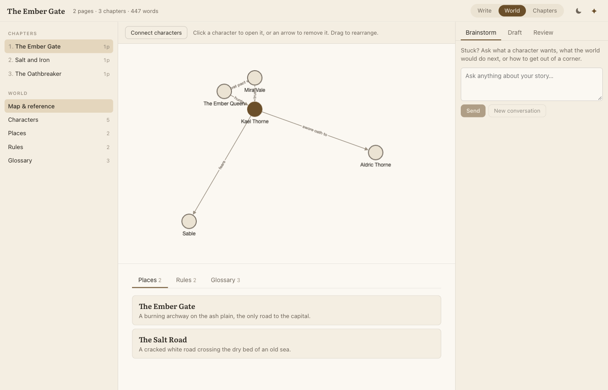
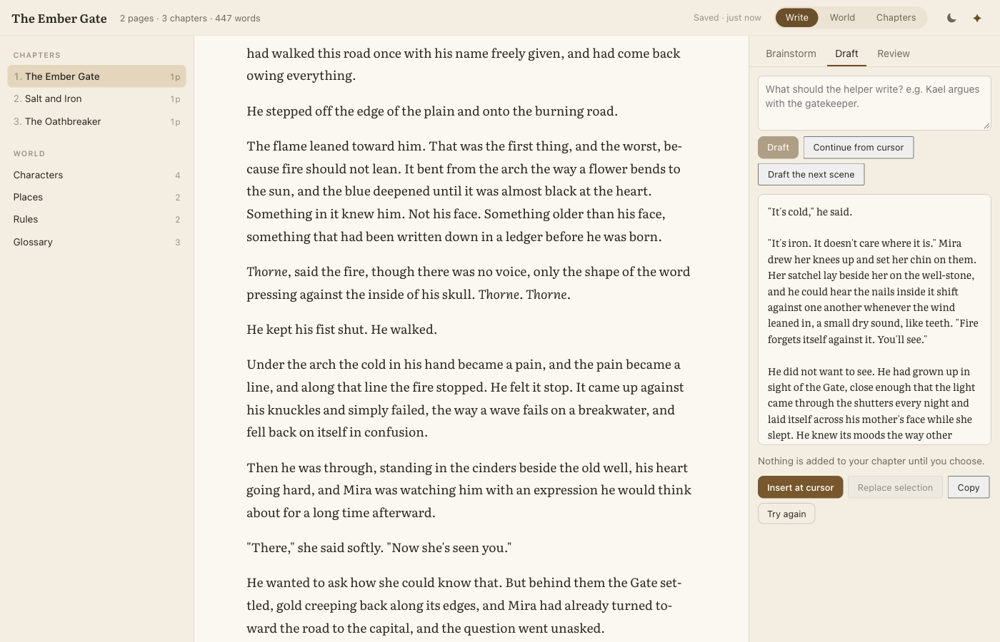

# Loreloom

A local, open-source novel-writing app for fantasy writers. You write in plain Markdown, keep your world (characters, places, rules, glossary) in cards, and get an AI helper that actually knows your world. Everything stays in a folder on your computer.





- **Write** chapters in a calm editor with page counts and word counts. Type `@` to link a character, place, rule or term.
- **Build your world** with cards for characters, places, rules and glossary terms, plus a relationship map.
- **Brainstorm, draft and review** with a helper that reads your cards and chapters. It never edits your chapters on its own: only your click on Insert, Replace or Apply changes your text.

## Install (for writers)

**Website and step-by-step guide: https://getloreloom.vercel.app**

On a Mac or Linux, open Terminal and paste:

```sh
curl -fsSL https://getloreloom.vercel.app/install.sh | bash
```

On Windows (preview), open PowerShell and paste:

```powershell
irm https://getloreloom.vercel.app/install.ps1 | iex
```

The installer sets everything up inside your user folder (no admin password), adds a Loreloom app you can open from Spotlight or the Start menu, and optionally installs Claude Code for the AI helper. Run it again to update. The installers live in [`site/`](site/) if you want to read them first.

## Requirements (developers)

- Node 22 or newer.
- Claude Code installed and signed in. Run `claude`, then `/login` in a terminal. See https://code.claude.com.
- A Claude plan. (An API-key option is on the roadmap.)

## Quick start (developers)

```sh
git clone https://github.com/prabhavmakkar/loreloom.git
cd loreloom
npm install
npm start -- ~/Writing/my-book
```

Loreloom opens in your browser at `http://127.0.0.1:4317`. If that port is busy it tries the next ones, up to 4327. The first time, choose **New book** or try the sample book.

The book folder can be given as an argument or through the `LORELOOM_BOOK` environment variable. With neither, it uses `~/Loreloom/my-book`. Add `--no-open` to stop it opening a browser tab.

## Where your book lives

Your book is a plain folder of Markdown files. Nothing is locked in:

```
my-book/
  book.yaml            title, author, settings
  chapters/<id>.md     one file per chapter
  world/characters/    character cards
  world/places/        place cards
  world/rules/         rules of your world
  world/glossary/      glossary terms
  .loreloom/           app state (session ids, trash)
```

Deleting a chapter or card moves it to `.loreloom/trash/`, and nothing is unlinked. Keep your book folder somewhere backed up, and consider running `git init` inside it. Your book is a separate folder from this repo, so your manuscript is never pushed by accident.

## Using it from Claude Desktop or Claude Code

Loreloom includes an MCP server so another assistant can read your chapters and read and write your world cards. Chapters are read-only over MCP. The running app picks up changes through its file watcher.

Tools: `list_chapters`, `read_chapter`, `list_cards`, `read_card`, `search_book`, `get_stats`, `create_card`, `update_card`, `add_relationship`.

**Claude Code** (use absolute paths, as Claude Code may run from any folder):

```sh
claude mcp add loreloom -- npx tsx /ABS/PATH/loreloom/packages/mcp/src/index.ts /ABS/PATH/my-book
```

**Claude Desktop**, in `claude_desktop_config.json`:

```json
{
  "mcpServers": {
    "loreloom": {
      "command": "npx",
      "args": [
        "tsx",
        "/ABS/PATH/loreloom/packages/mcp/src/index.ts",
        "/ABS/PATH/my-book"
      ]
    }
  }
}
```

Claude Desktop doesn't run from this repo, so use absolute paths. Replace `/ABS/PATH/loreloom` with where you cloned this repo and `/ABS/PATH/my-book` with your book folder. Restart Claude Desktop afterwards. Run `npm install` in the repo first.

## How authentication works

Loreloom runs your own installed Claude Code. You sign in through Anthropic's own flow (`claude`, then `/login`), and Loreloom never sees or stores your credentials. It never reads `~/.claude` or any tokens. The only thing it asks Claude Code is whether you are logged in. Usage counts against your own plan.

The helper runs with read-only tools (Read, Grep and Glob) inside your book folder: it can look things up, not edit or run anything.

Anthropic's terms: https://code.claude.com/docs/en/legal-and-compliance

## Tips

The helper picks up characters, places and terms whose name or alias appears in the text you're working on. Add short forms as aliases. If your card is "Kael Dunmore", add "Kael" as an alias so the helper finds it when a scene only says "Kael".

## Roadmap

- API-key provider, for people without a Claude plan
- AI-suggested cards
- Margin notes
- Export
- Desktop app

## Development

See [CONTRIBUTING.md](CONTRIBUTING.md). Run `npm test` and `npm run typecheck`.

## License

MIT. See [LICENSE](LICENSE).

Loreloom is not affiliated with Anthropic.
